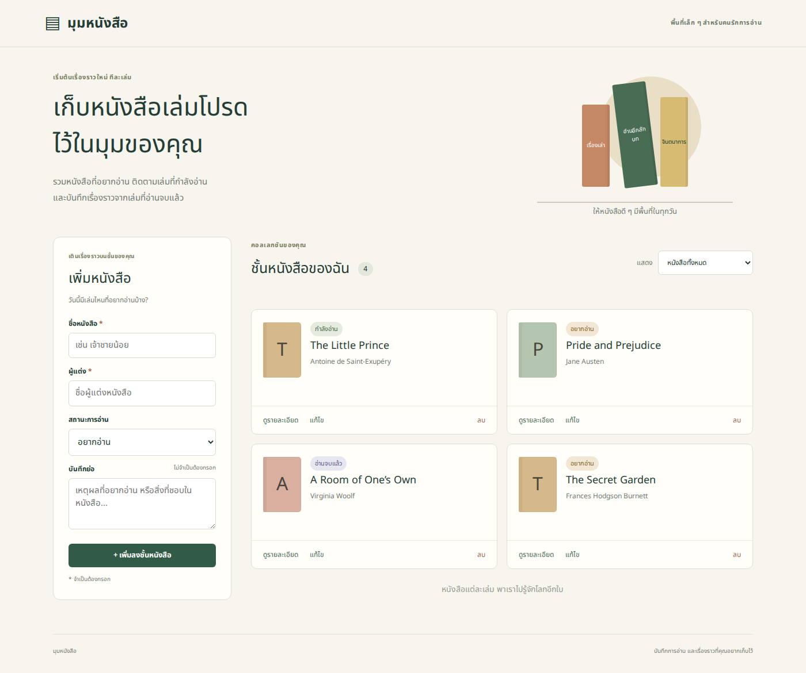
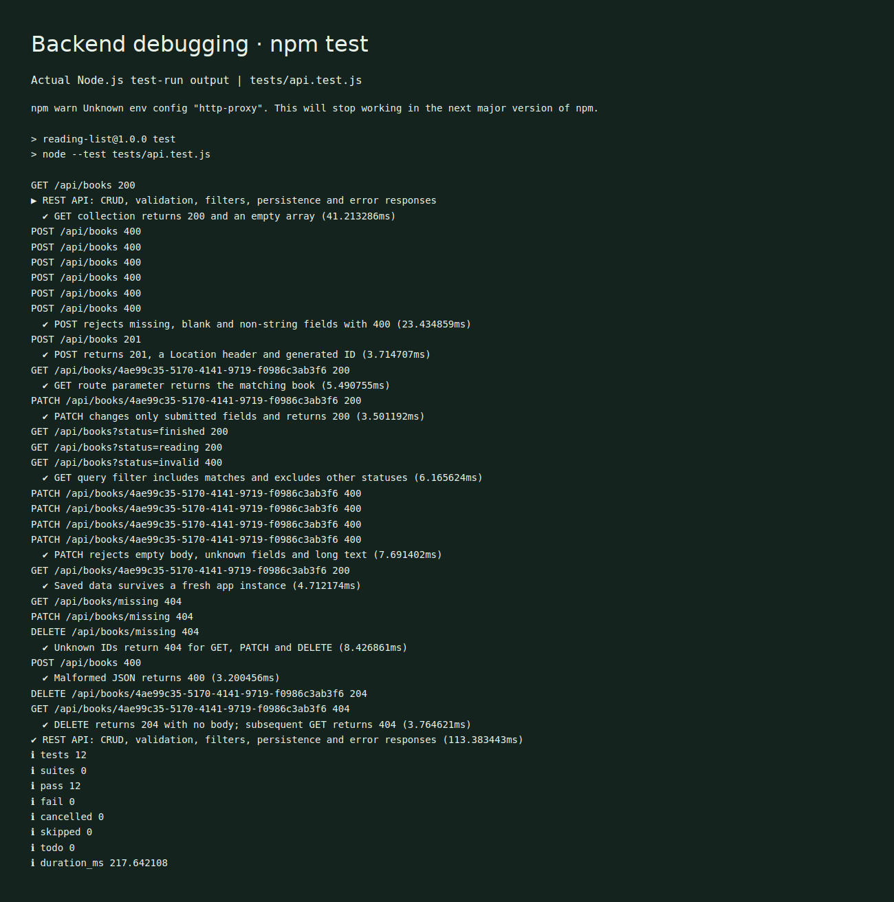
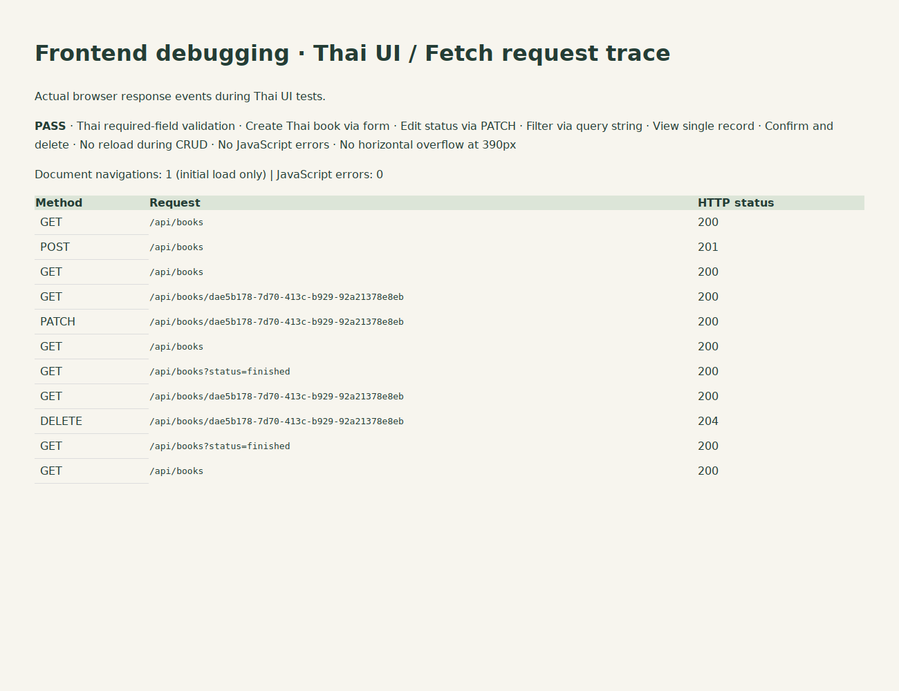

# มุมหนังสือ — Reading List

เว็บแอปภาษาไทยสำหรับจัดการหนังสือที่อยากอ่าน กำลังอ่าน และอ่านจบแล้ว พัฒนาด้วย Node.js + Express ฝั่งเซิร์ฟเวอร์ และ HTML/CSS/JavaScript ฝั่งไคลเอนต์ เรียก REST API ของตนเองด้วย `fetch()` เท่านั้น ไม่มี API, รูปภาพ หรือ CDN ภายนอกในหน้าเว็บ

## ติดตั้งและรัน (Windows CMD / Terminal)

1. ติดตั้ง Node.js เวอร์ชัน 22 ขึ้นไปที่มี npm
2. แตก ZIP แล้วเปิด Terminal ในโฟลเดอร์ `reading-list` ที่มี `package.json` (อย่ารันใน ZIP)
3. รันทีละคำสั่ง:

```bash
npm install
npm run dev
```

4. เปิดเบราว์เซอร์ที่ **http://localhost:3000** อย่าเปิด `public/index.html` โดยตรง
5. กด `Ctrl+C` ใน Terminal เมื่อต้องการหยุด

รันแบบปกติ: `npm start` · ทดสอบ API: `npm test`

ถ้า port 3000 ถูกใช้งาน ใน Windows CMD ให้รัน `set PORT=3001` ก่อน `npm run dev` แล้วเปิด http://localhost:3001

## โครงสร้างโปรเจกต์

```text
reading-list/
  server/
    app.js                 Express, validation, routes, JSON storage
    index.js               เปิดเซิร์ฟเวอร์
  public/
    index.html             ฟอร์ม รายการ ตัวกรอง และ dialog
    style.css              CSS responsive
    app.js                 fetch และอัปเดต DOM
  data/books.json          ข้อมูลตัวอย่างและข้อมูลที่บันทึก
  tests/api.test.js        ทดสอบ REST API ด้วย Node test runner
  docs/
    Reading_List_Report.pdf
    report.html            ต้นฉบับรายงานที่แก้ไขและพิมพ์เป็น PDF ได้
    screenshots/           ภาพใช้งานและหลักฐานดีบัก
    api-test-results.txt    ผลทดสอบ API จริง
    browser-test-results.json
  package.json
  package-lock.json
  .gitignore
  README.md
```

## การใช้งาน

- เพิ่ม: กรอก ชื่อหนังสือ และ Author เลือกสถานะ กด **เพิ่มลงชั้นหนังสือ**
- ดู: กด **ดูรายละเอียด** เพื่อดึงข้อมูลหนังสือเล่มเดียวจาก API
- แก้ไข: กด **แก้ไข** ข้อมูลจะแสดงในฟอร์ม แก้แล้วกด **บันทึกการแก้ไข** หรือ **ยกเลิกการแก้ไข**
- ลบ: กด **ลบ** แล้วกดยืนยัน **ยืนยันลบหนังสือ**
- กรอง: เลือก **หนังสือทั้งหมด / อยากอ่าน / กำลังอ่าน / อ่านจบแล้ว**
- หลังเพิ่ม แก้ไข หรือลบ จะดึงรายการใหม่ด้วย fetch โดยไม่รีโหลดหน้า ตัวกรองเดิมยังคงทำงาน ดังนั้นหนังสือที่ไม่ตรงตัวกรองจะไม่ปรากฏ

## รูปแบบข้อมูล

| ฟิลด์ | ชนิด | กติกา |
|---|---|---|
| id | string | เซิร์ฟเวอร์สร้าง UUID สำหรับรายการใหม่ แก้ไขไม่ได้; ข้อมูลตัวอย่างใช้ b1-b4 |
| title | string | บังคับ 1–120 ตัวอักษรหลัง trim |
| author | string | บังคับ 1–80 ตัวอักษรหลัง trim |
| status | string | want-to-read, reading หรือ finished; POST ที่ไม่ส่งค่าจะใช้ want-to-read |
| notes | string | ไม่บังคับ ยาวไม่เกิน 1,000 ตัวอักษร ค่าเริ่มต้นเป็นข้อความว่าง |

POST ต้องส่ง title และ author; PATCH ส่งเฉพาะฟิลด์ที่แก้ได้อย่างน้อยหนึ่งฟิลด์ ตรวจค่าที่ส่งเข้ามาทุกครั้ง ไม่รับฟิลด์อื่น Body ต้องเป็น JSON object

## REST API ที่ออกแบบ

Base URL: `http://localhost:3000` · Request/response ที่มี body ใช้ JSON

| Method | Endpoint | หน้าที่ | สำเร็จ | กรณีผิดพลาด |
|---|---|---|---|---|
| GET | /api/books | คืน array ทั้งหมด | 200 | 500 เมื่ออ่านข้อมูลไม่ได้ |
| GET | /api/books?status=reading | คืน array ที่ตรงสถานะ | 200; ไม่พบคืน [] | 400 สถานะไม่ถูกต้อง |
| GET | /api/books/:id | คืน object เล่มเดียว | 200 | 404 ไม่พบ |
| POST | /api/books | เพิ่มหนังสือ | 201 + object + Location header | 400 ข้อมูลไม่ครบ/ไม่ถูกต้อง |
| PATCH | /api/books/:id | แก้บางฟิลด์ | 200 + object ที่แก้แล้ว | 404 ไม่พบ; 400 ข้อมูลไม่ถูกต้อง |
| DELETE | /api/books/:id | ลบหนังสือ | 204 ไม่มี response body | 404 ไม่พบ |

JSON เสียรูปแบบคืน 400; body เกิน 32 KB คืน 413; endpoint ภายใต้ /api ที่ไม่มีคืน 404

ตัวอย่าง POST `/api/books`:

```json
{"title":"The Little Prince","author":"Antoine de Saint-Exupéry","status":"want-to-read","notes":"Read this weekend"}
```

ตัวอย่าง response 201 (`id` เป็นค่าที่เซิร์ฟเวอร์สร้าง):

```json
{"id":"generated-uuid","status":"want-to-read","notes":"Read this weekend","title":"The Little Prince","author":"Antoine de Saint-Exupéry"}
```

ตัวอย่าง PATCH `/api/books/<id>`: `{"status":"finished"}`

ตัวอย่าง error 404: `{"error":"ไม่พบหนังสือเล่มนี้"}`

## การทำงานของระบบ

Browser → fetch('/api/books') → Express route → data/books.json → JSON response → JavaScript อัปเดต DOM

Frontend ใช้ `preventDefault()` หยุดการ submit แบบเปลี่ยนหน้า และรอ fetch สำเร็จก่อนโหลดรายการใหม่ ใช้ `textContent` แสดงข้อความที่ผู้ใช้ป้อน มีการแจ้งข้อผิดพลาดและปุ่มลองโหลดใหม่ DELETE 204 จะไม่เรียก response.json() เพราะไม่มี body

ไฟล์ JSON เก็บข้อมูลต่อเนื่องหลังหยุดเซิร์ฟเวอร์ เหมาะกับงานสาธิตที่รัน Node.js หนึ่ง process ไม่ใช่ระบบหลายเซิร์ฟเวอร์ ไม่มีระบบล็อกอิน ไม่เก็บข้อมูลส่วนบุคคลจริงลง repository

## ภาพหน้าเว็บ



ภาพขั้นตอนเพิ่มเติมอยู่ใน [รายงาน PDF](docs/Reading_List_Report.pdf) และ `docs/screenshots/`

## หลักฐานการดีบัก 2 ภาพ

โจทย์ที่ได้รับไม่ได้ระบุว่าต้องเป็น debugger ชนิดใด ภาพต่อไปนี้ใช้ผลรันจริงจากการทดสอบ ไม่ใช่ภาพจำลอง แต่ไม่ได้เป็นภาพ breakpoint ใน VS Code หรือภาพ Chrome DevTools โดยตรง หากอาจารย์มีข้อกำหนดเพิ่มเติม ให้ถ่ายภาพตามนั้นจากเครื่องนักศึกษาแทน

### 1. Backend: ผล npm test

ตรวจ CRUD, status code, validation, query string, ID ที่ไม่มี และข้อมูลที่คงอยู่เมื่อสร้าง app instance ใหม่ ทดสอบด้วยไฟล์ชั่วคราวแยกจากข้อมูลผู้ใช้



ผลข้อความฉบับเต็ม: [api-test-results.txt](docs/api-test-results.txt)

### 2. Frontend: บันทึก fetch จากเบราว์เซอร์

ภาพสรุป actual browser response events ขณะกดปุ่มและกรอกฟอร์ม ทดสอบ POST, GET, PATCH, DELETE, filtering และยืนยันว่า CRUD ไม่ทำให้ document โหลดใหม่ พร้อมตรวจ JavaScript errors



ข้อมูลจริง: [browser-test-results.json](docs/browser-test-results.json)


